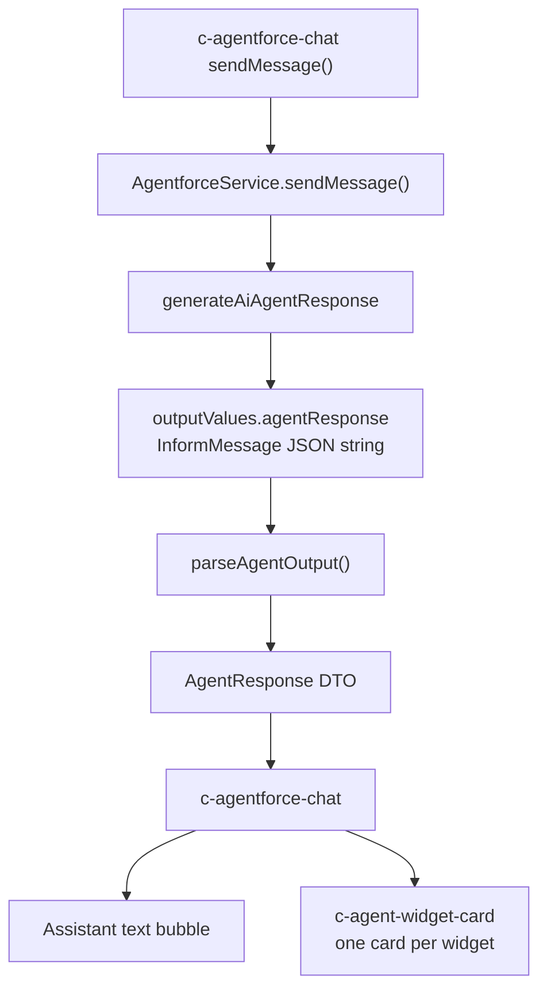
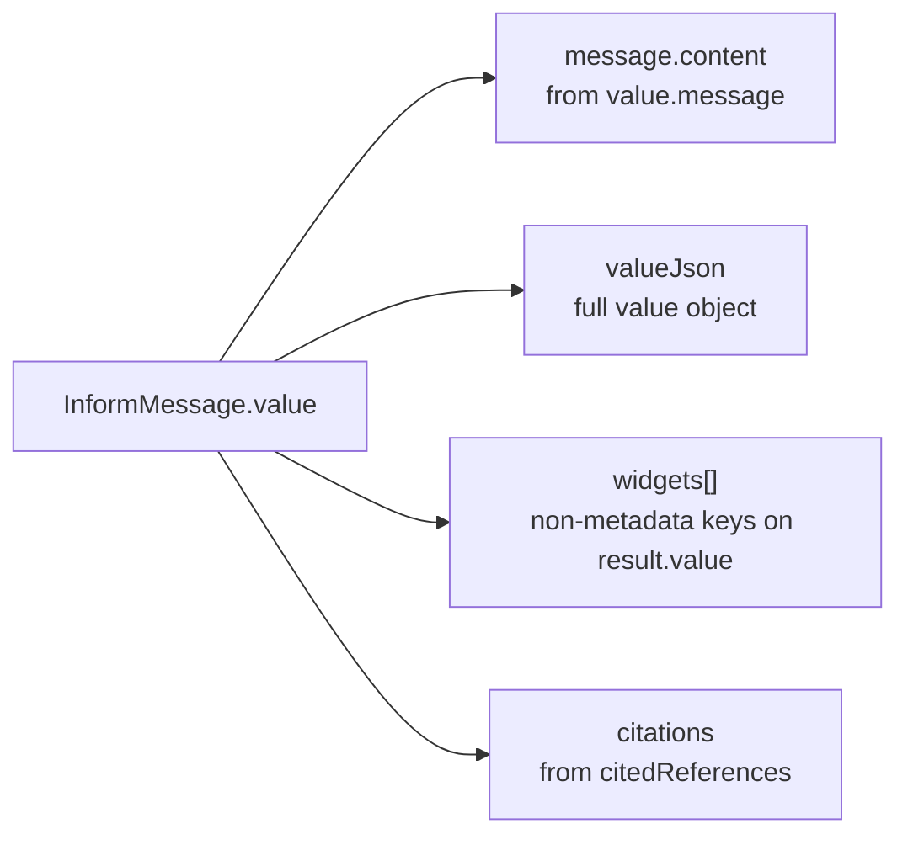
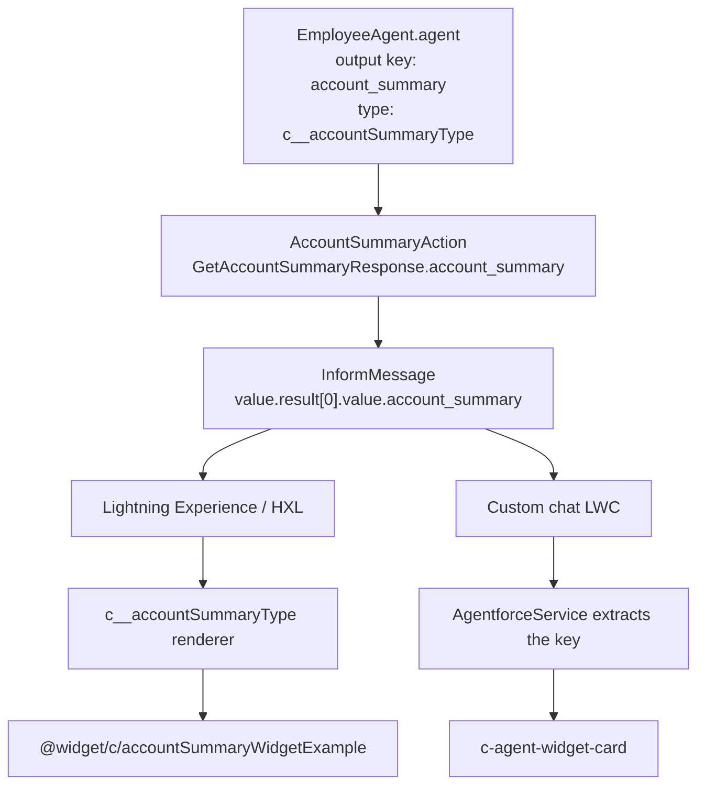

# How an Agentforce Response Is Transformed

This document describes the path from a raw `generateAiAgentResponse` result to what `c-agentforce-chat` displays, and how action output keys are bound to Lightning Types.

Widget names are not hardcoded. They come from agent action output keys in Agent Script.

## Pipeline

GitHub renders the diagrams below from [Mermaid](https://docs.github.com/en/get-started/writing-on-github/working-with-advanced-formatting/creating-diagrams) fenced blocks.



`parseAgentOutput()` maps the envelope like this:



Standard Agentforce / HXL can also render the same structured key through a Lightning Type. That binding is declared on the action output, not inferred from folder names. See [Action output binding](#action-output-binding).

## 1. Raw invocable output

`AgentforceService` calls the platform action `generateAiAgentResponse`. A successful result looks like:

```json
[
  {
    "actionName": "SearchAgent",
    "isSuccess": true,
    "outputValues": {
      "sessionId": "01a0a3c8-e9e9-76b3-adb0-6f1724d0bcee",
      "agentResponse": "{ ... InformMessage JSON ... }"
    }
  }
]
```

`agentResponse` is a JSON **string**, not a parsed object. Apex deserializes it next. A captured example lives in `sample response.json`.

## 2. InformMessage envelope

After parsing, the envelope is:

```json
{
  "type": "InformMessage",
  "value": {
    "message": "Natural-language assistant reply.",
    "result": [
      {
        "value": {
          "<action_output_key>": {},
          "error_message": null,
          "is_success": true
        }
      }
    ],
    "citedReferences": [],
    "feedbackId": "...",
    "isContentSafe": true
  }
}
```

| Path                                       | Meaning                                    |
| ------------------------------------------ | ------------------------------------------ |
| `value.message`                            | Text shown in the chat bubble              |
| `value.result[]`                           | Zero or more action results from this turn |
| `value.result[].value`                     | Serialized action outputs                  |
| `value.result[].value.<action_output_key>` | Displayable structured payload             |
| `value.citedReferences`                    | Optional citations                         |

`result` can be empty. In that case the UI shows only `value.message`.

## 3. Where `<action_output_key>` comes from

The structured key is the action output name in Agent Script, not the Lightning Type folder name.

```yaml
outputs:
    "<action_output_key>": object
        is_displayable: True
        complex_data_type_name: "c__someLightningType"
```

That quoted name must match the Apex `@InvocableVariable` on the action response wrapper. Agentforce copies it into `result[].value`.

`is_displayable: True` tells standard Agentforce surfaces to render the payload with the Lightning Type. `complex_data_type_name` is that type. The custom chat LWC does not resolve Lightning Types; it only consumes the key and payload.

## 4. Apex transformation (`AgentforceService`)

`parseAgentOutput()` normalizes the envelope into a DTO the LWC can use.

Returned `AgentResponse`:

| Field             | Source                                                 | UI use                   |
| ----------------- | ------------------------------------------------------ | ------------------------ |
| `message.content` | `outputValues.response`, else `value.message`          | Assistant text           |
| `sessionId`       | `outputValues.sessionId`                               | Conversation continuity  |
| `requestId`       | `outputValues.requestId`                               | Traceability             |
| `citations`       | `outputValues.citations`, else `value.citedReferences` | Citation list            |
| `valueJson`       | serialized `InformMessage.value`                       | Fallback parse / history |
| `widgets`         | extracted from `value.result[].value`                  | Structured cards         |

Widget extraction is generic:

1. Walk every item in `value.result`.
2. Read `item.value` as a map of action outputs.
3. Skip metadata keys: `error_message`, `errorMessage`, `is_success`, `isSuccess`, `error_type`, `errorType`.
4. Keep remaining keys whose values are objects or lists.
5. Emit `{ name: "<action_output_key>", payloadJson: "<serialized payload>" }`.

Several widgets can be returned in one turn if the agent ran several displayable actions, or one action exposed several object outputs.

## 5. LWC transformation (`c-agentforce-chat`)

The chat component:

1. Shows `message.content` as the assistant bubble.
2. Parses `widgets` (or rebuilds them from `valueJson` if needed).
3. Renders each widget with `c-agent-widget-card`.
4. Stores `valueJson` and widgets on the message so history can restore cards.

`c-agent-widget-card` is a generic renderer:

- Object fields become labeled values
- Nested objects and lists become sections
- Strings starting with `http://` or `https://` become links
- Objects with `label` + `prompt` become buttons that send the prompt back to the agent

No widget-specific component is selected from the output key.

## 6. Worked example

Raw `result[0].value`:

```json
{
  "account_summary": { "accountName": "Annie Dubois" },
  "error_message": null
}
```

After Apex:

```json
{
  "message": {
    "role": "assistant",
    "content": "Here is a structured summary..."
  },
  "sessionId": "01a0a3c8-...",
  "valueJson": "{ \"result\": [ ... ], \"message\": \"...\" }",
  "widgets": [
    {
      "name": "account_summary",
      "payloadJson": "{ \"accountName\": \"Annie Dubois\" }"
    }
  ]
}
```

The chat shows the text plus a generic card titled **Account Summary**. The same path would display `fund_list` or `generic_section` if those were the action output keys.

## Action output binding

The JSON key is declared on the agent action. There is no automatic rename such as `account_summary` → `accountSummaryType`. Agent Script is the join table between the JSON key, the Apex field, and the Lightning Type.

### Employee Agent example

In `force-app/main/default/aiAuthoringBundles/EmployeeAgent/EmployeeAgent.agent`:

```yaml
Get_Account_Summary:
    target: "apex://AccountSummaryAction"
    outputs:
        "account_summary": object
            label: "Account Summary"
            is_displayable: True
            complex_data_type_name: "c__accountSummaryType"
        "error_message": string
        "is_success": boolean
```



| Identifier                                  | Where it is defined                       | What it is                                  |
| ------------------------------------------- | ----------------------------------------- | ------------------------------------------- |
| `"account_summary"`                         | Action `outputs` in `EmployeeAgent.agent` | JSON key in the agent response              |
| `c__accountSummaryType`                     | `complex_data_type_name` on that output   | Custom Lightning Type (CLT)                 |
| `lightningTypes/accountSummaryType/`        | Metadata folder                           | CLT bundle named `accountSummaryType`       |
| `AccountSummaryAction$AccountSummaryResult` | CLT `schema.json`                         | Apex class that describes the payload shape |
| `accountSummaryWidgetExample`               | CLT `renderer.json`                       | Widget used in standard Agentforce UI       |
| `apex://AccountSummaryAction`               | Action `target`                           | Apex invocable that produces the payload    |

`c__` is the unpackaged namespace prefix. The Lightning Type API name is therefore `c__accountSummaryType`.

The Apex response wrapper must use the same field names:

```apex
global class GetAccountSummaryResponse {
  @InvocableVariable
  public AccountSummaryResult account_summary;

  @InvocableVariable
  public Boolean is_success;

  @InvocableVariable
  public String error_message;
}
```

The CLT describes the object **inside** the key, not the key itself:

```json
{
  "lightning:type": "@apexClassType/c__AccountSummaryAction$AccountSummaryResult"
}
```

`renderer.json` maps that type to a widget for Lightning Experience / HXL. The custom chat LWC does not use that renderer.

### Adding another widget output

1. Add an `@InvocableVariable` on the Apex response wrapper, for example `fund_list`.
2. Declare the same output key on the action in the `.agent` file.
3. Set `complex_data_type_name` to the CLT, for example `c__natixisFundListType`.
4. Point the CLT `schema.json` at the Apex payload class and `renderer.json` at the widget.

The response key will be `fund_list` because that is the action output name.

## Related files

| File                                                                          | Role                                          |
| ----------------------------------------------------------------------------- | --------------------------------------------- |
| `force-app/main/default/classes/AgentforceService.cls`                        | Parse InformMessage, extract widgets          |
| `force-app/main/default/lwc/agentforceChat/`                                  | Call Apex, attach widgets to messages         |
| `force-app/main/default/lwc/agentWidgetCard/`                                 | Generic structured payload UI                 |
| `sample response.json`                                                        | Captured raw invocable output                 |
| `force-app/main/default/aiAuthoringBundles/EmployeeAgent/EmployeeAgent.agent` | Action output keys and Lightning Type binding |
| `force-app/main/default/classes/AccountSummaryAction.cls`                     | Example invocable payload                     |
| `force-app/main/default/lightningTypes/accountSummaryType/`                   | Example CLT schema and renderer               |
| `force-app/main/default/uiWidgets/accountSummaryWidgetExample/`               | Example HXL widget                            |
